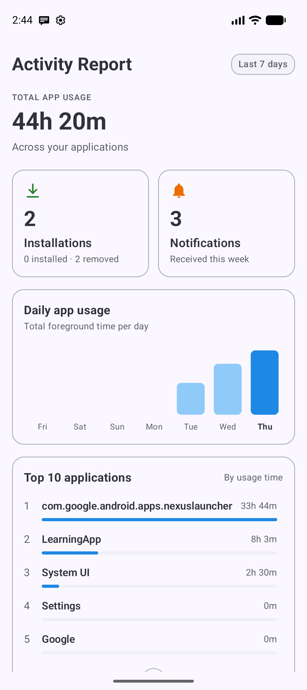
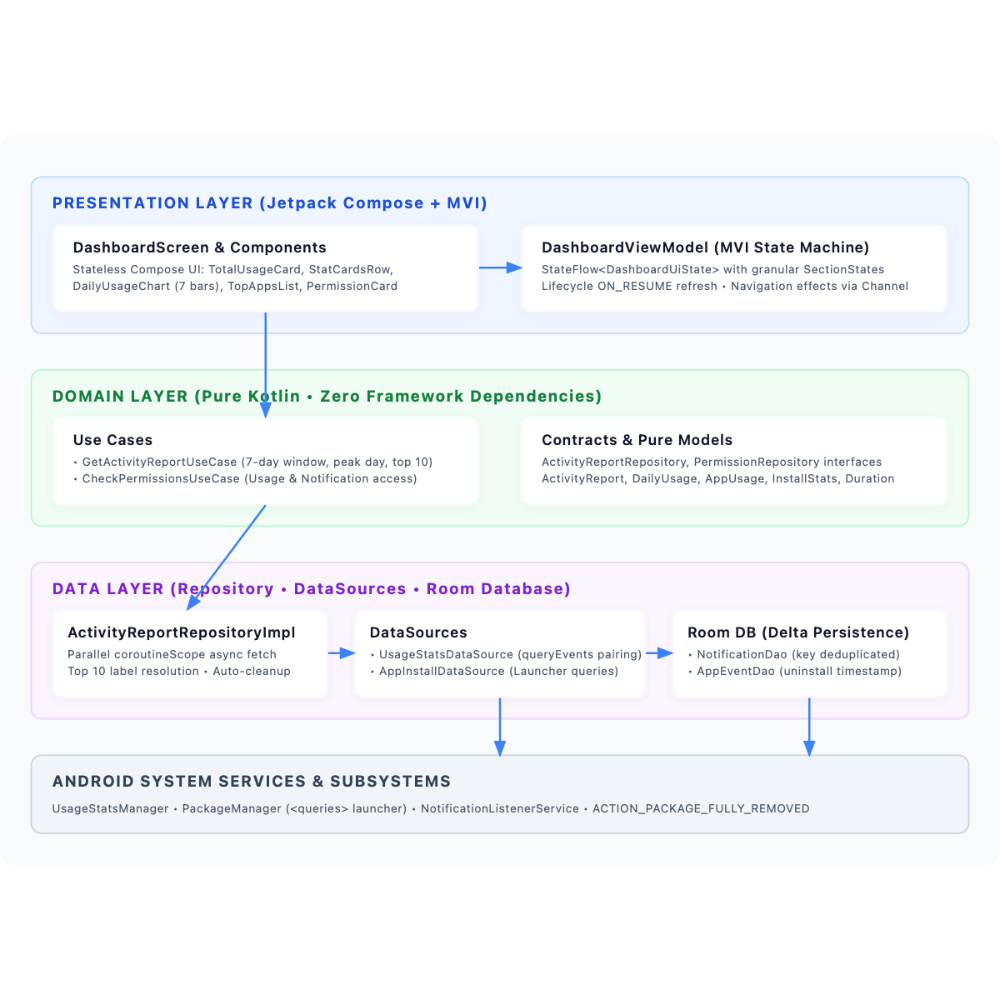

# Weekly Activity Report

An Android app that shows what you did on your phone over the **last 7 local calendar days**: screen time per day (with peak day highlighted), your top 10 apps, apps installed and removed, and incoming notifications.

<p align="center">
  
</p>

- **Screenshots**: [`docs/screenshots/`](docs/screenshots/)
- **Diagrams**: [`docs/diagrams/`](docs/diagrams/)
- **Sketches**: [`docs/sketches/`](docs/sketches/)

---

## The Question

> *"A user would like to review what they did and saw on their phone during the week. What trade-offs would you make to offer a solution that is comprehensive, efficient and/or practical, and why?"*

---

## My Assumptions

- **One user, one device**: No internet permission; nothing leaves the phone.
- **Last 7 local calendar days**: "The week" means the **last 7 local days** ending today (`today - 6 days at 00:00` to `now`). There is no date picker, keeping the app focused and fast.
- **Honesty over vanity**: If a number can't be measured reliably, I don't show it.
- **Avoids restricted permissions**: No `QUERY_ALL_PACKAGES`, no accessibility services, and no root. Built with standard Android APIs.

---

## What the App Shows

| Data | Source | Why |
|---|---|---|
| **Total screen time + 7 daily bars** (peak day highlighted) | `UsageStatsManager.queryEvents` | The core answer to weekly time expenditure. Calculated by pairing foreground and background events. |
| **Top 10 apps by duration** | Same paired events, grouped by app | Shows where time actually went, with bars relative to the top app. |
| **Apps installed** | `PackageManager` (`firstInstallTime`) | Launchable apps installed during the week. Instant read, no background battery drain. |
| **Apps removed** | `PACKAGE_FULLY_REMOVED` broadcast → Room | Android doesn't keep a removal history, so we log it passively when it happens. |
| **Notifications received** | `NotificationListenerService` → Room | Android doesn't keep a notification history. Non-ongoing alerts are deduplicated and logged. |

---

## What I Left Out, and Why

- **Video watched, ads seen, social media content**: Reading content inside other apps requires an accessibility service or continuous screen capture. That is invasive, battery-heavy, hard to justify on Google Play, and unreliable across app updates. I chose user privacy and reliability over intrusive coverage.
- **How often apps are opened**: Android fires a new `ACTIVITY_RESUMED` event whenever an app changes screens, tabs, or rotates. Counting these produces inflated, unreliable numbers.

---

## Main Trade-offs

1. **Raw events instead of aggregated stats**:  
   `queryUsageStats` is simpler, but system buckets don't line up with local midnight, causing daily bars to disagree with the weekly total. Pairing raw foreground/background events and splitting sessions at midnight guarantees consistency: the daily bars always add up to the total.
2. **Read what Android already records; store only what it doesn't**:  
   Android keeps its own record of when apps open and close, so screen time is read when the dashboard opens. Android keeps no history of notifications or removals, so those are saved to Room as they happen. No scheduled jobs, so no battery cost.
3. **Tracking begins on permission grant**:  
   Notifications and removals can only be counted from the moment permission is enabled. The first week is partial; this is listed under Known Limitations.
4. **Each notification counted once**:  
   Apps update notifications frequently for playback or chat. We store alerts by their unique key; a repeated key is ignored. Ongoing services and group summaries are skipped.
5. **Scoped launcher visibility instead of `QUERY_ALL_PACKAGES`**:  
   We declare `<queries>` for `MAIN`/`LAUNCHER` intents. "Installed apps" reflects user-facing launchable apps, avoiding restricted Play Store permissions.
6. **Each card handles its own permission**:  
   Usage access is required for the report. Notification access is optional: if omitted, the dashboard displays usage and installs normally, and only the notification card shows an inline "Grant access" prompt.

---

## Architecture

Clean Architecture with three layers. MVI: the screen sends actions, the ViewModel sends back one state.

<p align="center">
  
</p>

- **Domain** (pure Kotlin): Business models (`ActivityReport`, `DailyUsage`, `AppUsage`), repository interfaces, and use cases (`GetActivityReportUseCase`, `CheckPermissionsUseCase`). 7-day window boundaries, peak day logic, and top-10 ranking live here so tests run without a device.
- **Data**: `UsageStatsDataSource` (raw session pairing), `AppInstallDataSource` (launcher queries), Room persistence (`NotificationDao`, `AppEventDao`), and `ActivityReportRepositoryImpl` which fetches sources in parallel.
- **Presentation**: Jetpack Compose + `DashboardViewModel`. Each card handles its own permission state (loading / content / permission required / error) and refreshes when you come back to the app.

> Additional diagrams and vector assets are in [`docs/diagrams/`](docs/diagrams/).

**Tech Stack**: Kotlin, Jetpack Compose, Material 3, Hilt, Room, Coroutines/Flow. `minSdk 26`, `targetSdk 36`.

---

## Testing & Quality

Business logic (use cases, usage calculation) is well covered; UI and Android wrappers are checked manually on the emulator.

- **Use cases**: 7-day window boundary computation in non-UTC timezones, peak day calculation (including zero-day edge cases), and top-10 ranking.
- **Usage calculation**: A session crossing midnight is split between days; empty days are 0.
- **Repository**: Notifications are skipped when access is off.
- **ViewModel**: Missing permission shows the permission card; the settings button sends a navigation effect.
- **Room (Instrumented)**: Duplicate notifications are counted once.

### Quality Gates (`./scripts/verify-ci.sh`)

Every PR runs ktlint, detekt, Android lint, unit tests with JaCoCo coverage, and a debug build on GitHub Actions (and locally with `./scripts/verify-ci.sh`):
1. **KtLint**: Android Studio code style check (0 violations).
2. **Detekt**: Static analysis for complexity and line length thresholds (0 issues).
3. **Android Lint**: Static checks ensuring API 26+ compatibility (0 errors).
4. **Unit Tests & JaCoCo**: 18 unit tests + coverage report.
5. **Debug Assembly**: Complete APK build verification (`assembleDebug`).

---

## How to Run

1. Open the project in Android Studio and run the `app` configuration (Android 8.0+ / API 26+).
2. Tap **Grant access** on the initial prompt to enable *Usage access*.
3. Optional: Tap **Grant access** on the notifications card to enable *Notification access*.

**Simulate events**:

- Post a test notification (updates the notification card on resume):
  ```bash
  adb shell cmd notification post -t "Test Alert" tag1 "Hello from adb"
  ```
- Test app uninstallation tracking:  
  Install any app from the Play Store, uninstall it, then reopen the dashboard.

---

## Known Limitations

- Android keeps detailed usage events only for a limited time (about a week on most devices), which fits the 7-day window but doesn't allow longer history.
- If an app was already open before the 7-day window started, the start of that initial session isn't captured.
- Notification and uninstall counts accumulate from the moment the app/permission is enabled.
